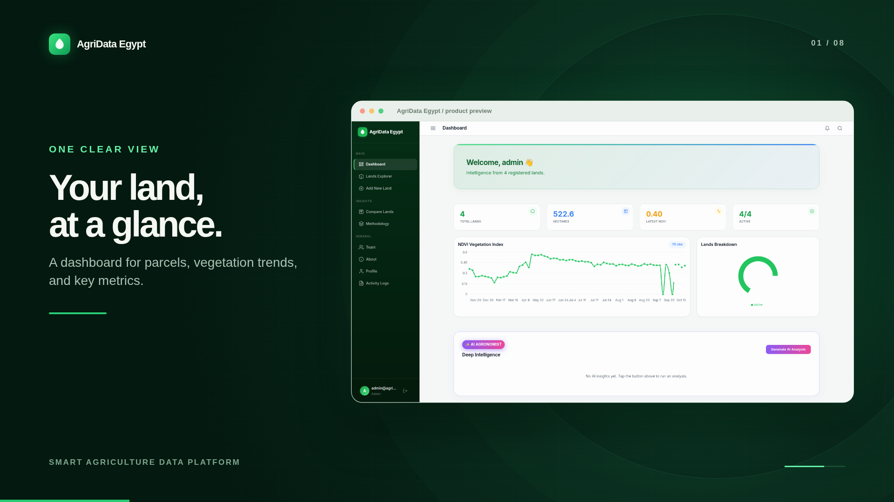
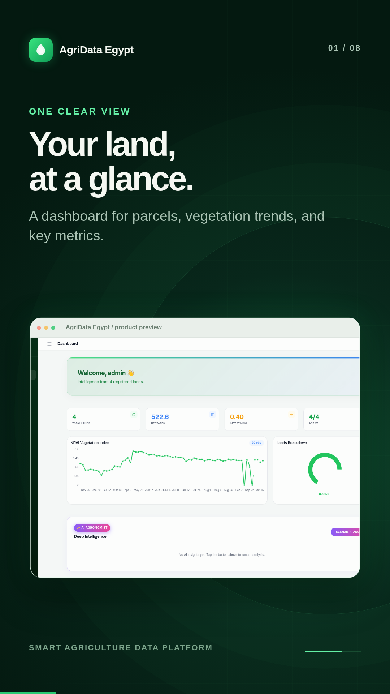
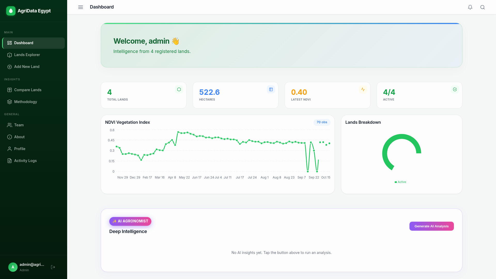
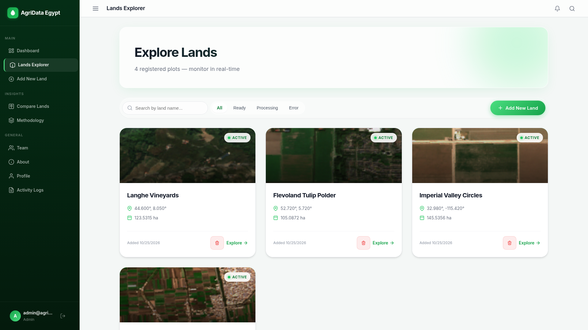
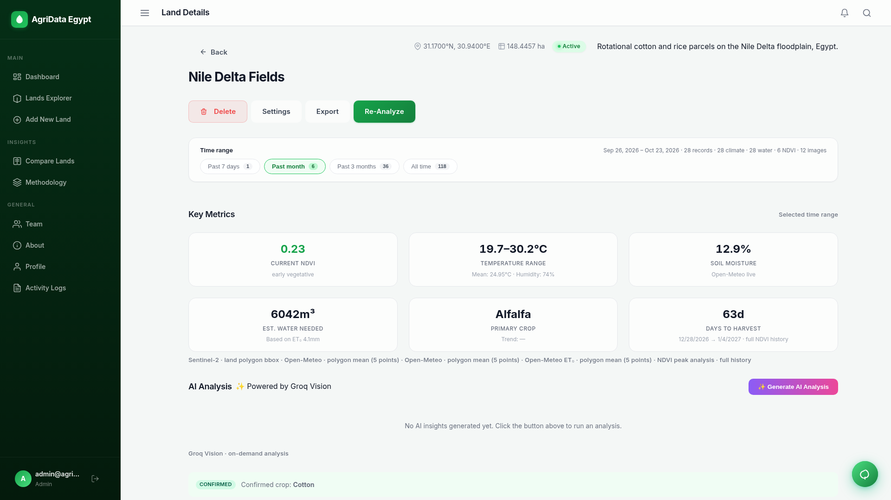
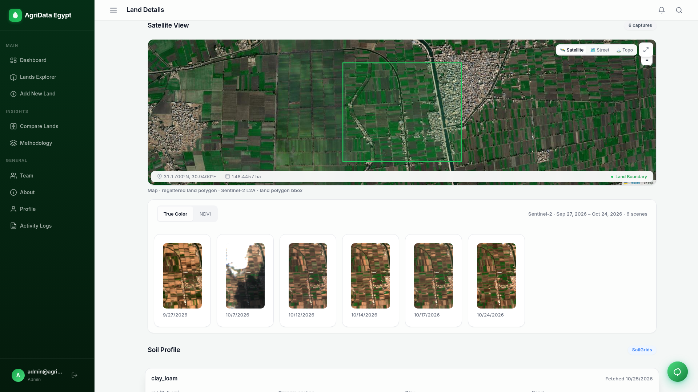
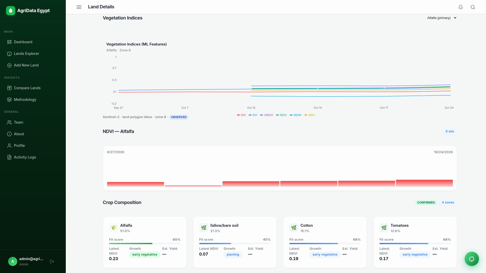
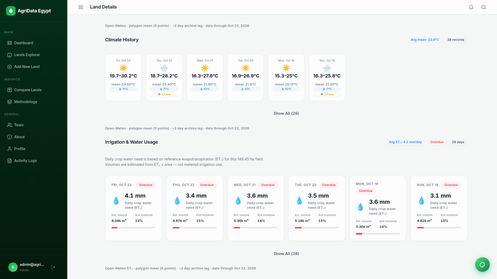
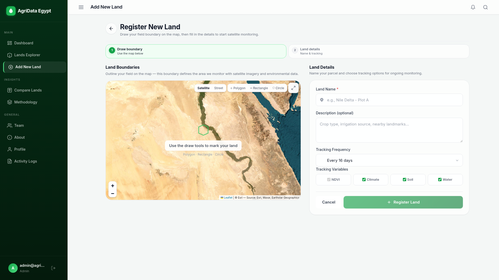
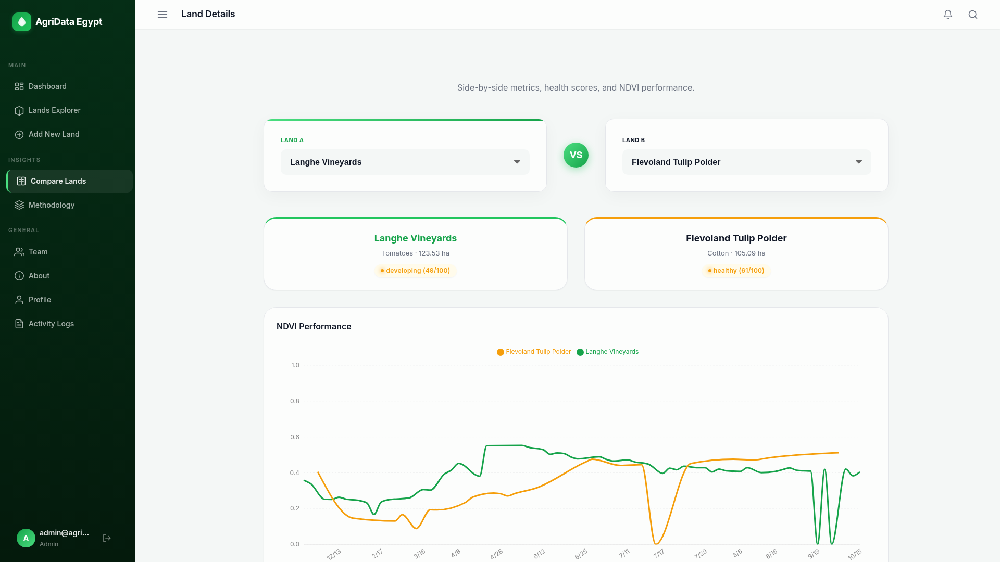

# Smart Agriculture Data Platform

A scalable, containerized architecture for agricultural data processing, analysis, and visualization.

<p align="center">
  <strong>AgriData Egypt</strong><br />
  Satellite-powered field monitoring, crop intelligence, and land management in one workspace.
</p>

## Product Tour

### Watch the product film

<p align="center">
  <a href="docs/media/agri-promo-wide.mp4"></a>
</p>

**[Watch the 16:9 film](docs/media/agri-promo-wide.mp4)** · **[Watch the 9:16 vertical cut](docs/media/agri-promo-vertical.mp4)**

<p align="center">
  <a href="docs/media/agri-promo-vertical.mp4"></a><br />
  <sub>Vertical cut for mobile viewing</sub>
</p>

### Explore the interface

The screenshots below show the application running with sample agricultural data. Open any image to view it at full resolution.

<p align="center">
  <a href="docs/media/screenshots/01-dashboard.png"></a>
</p>

<table>
  <tr>
    <td width="50%"><a href="docs/media/screenshots/02-lands-explorer.png"></a><br /><strong>Land portfolio</strong><br />Browse registered parcels and jump into a field at a glance.</td>
    <td width="50%"><a href="docs/media/screenshots/03-field-metrics.png"></a><br /><strong>Field intelligence</strong><br />Review crop health, growing conditions, and land-level analytics.</td>
  </tr>
  <tr>
    <td width="50%"><a href="docs/media/screenshots/04-satellite-view.png"></a><br /><strong>Satellite monitoring</strong><br />Inspect parcel boundaries, imagery, and observation history.</td>
    <td width="50%"><a href="docs/media/screenshots/03b-vegetation-indices.png"></a><br /><strong>Vegetation insights</strong><br />Track NDVI trends and review crop health signals over time.</td>
  </tr>
  <tr>
    <td width="50%"><a href="docs/media/screenshots/05-climate-history.png"></a><br /><strong>Climate context</strong><br />See environmental conditions alongside field performance.</td>
    <td width="50%"><a href="docs/media/screenshots/07-register-land.png"></a><br /><strong>Map-based registration</strong><br />Draw a field boundary and configure its monitoring variables.</td>
  </tr>
</table>

<p align="center">
  <a href="docs/media/screenshots/06-compare-lands.png"></a><br />
  <strong>Compare fields</strong> — inspect multiple parcels side by side.
</p>

## 🏗️ Architecture & Project State

The project was recently restructured to provide a clean, microservices-oriented environment. Background jobs, task queues (Celery/Redis), and object storage references have been intentionally removed to streamline the platform around a lightweight REST API and direct database integration.

### Core Services

The platform uses a clean **multi-container architecture** (preferred over single-container) orchestrated via `docker-compose.yml`:

1. **`agri_nginx`** (Reverse Proxy)
   - **Tech Stack**: NGINX
   - **Role**: API Gateway and reverse proxy.
   - **Routing**:
     - `/api/` -> FastAPI Backend (port 8000)
     - `/` + HMR -> Frontend Vite dev server (port 5173)
   - **Exposed Port**: `80`

2. **`agri_frontend`** (Web Client)
   - **Tech Stack**: React + Vite + Node.js
   - **Role**: UI. Supports hot-reload in development via volume mount.
   - **Exposed Port**: `5173` (internal)

3. **`agri_backend`** (REST API)
   - **Tech Stack**: Python 3.11, FastAPI, Uvicorn, SQLAlchemy, Pandas + xlsxwriter
   - **Role**: Core logic, lands, analytics, pipelines, AI.
   - **Exposed Port**: `8000`

4. **`agri_postgres`** (Relational Database)
   - **Tech Stack**: PostgreSQL 14
   - **Role**: Primary data store. Initialized via Database/init.sql + seed.sql. Persistent volume.
   - **Internal Port**: 5432 (mapped to host 5432)

5. **`agri_scheduler`** (Background Scheduler)
   - **Tech Stack**: Python 3.11 + APScheduler (reuses backend image)
   - **Role**: Periodic land monitoring jobs.
   - **Command**: `python -m app.scheduler.runner`

A single-container `Dockerfile` (at root) also exists for simplified deploys (e.g. some Azure scenarios) that bundles built frontend + backend. **Multi-container is the recommended approach** for maintainability and separation of concerns.

---

## 📂 Project Structure

```text
Smart-Agriculture-Data-Platform/
│
├── .env.backend                 # Environment variables for FastAPI backend
├── .env.db                      # Environment variables for MySQL database
├── docker-compose.yml           # Multi-container orchestration config
│
├── data/                        # Persistent local data volumes
│   ├── csv/                     # Raw agricultural CSV datasets
│   ├── docs/                    # Related data documentation
│   └── images/                  # Images for OpenCV processing
│
├── infra/
│   ├── azure/                   # Deployment scripts & Azure configs
│   └── nginx/                   # NGINX configuration and Dockerfile
│       └── conf.d/default.conf  # Proxy routing configuration
│
├── services/
│   ├── backend/                 # FastAPI Source Code & Dockerfile
│   │   ├── requirements.txt     # Python dependencies
│   │   └── app/                 # Backend application modules
│   │       ├── api/             # API Router endpoints
│   │       ├── core/            # App configurations and constants
│   │       ├── models/          # SQLAlchemy Database Models
│   │       ├── db/              # Database connection bindings
│   │       ├── users/           # User authentication logic
│   │       ├── ai/              # AI predictive logic
│   │       ├── cv/              # Bridge to computer vision tasks
│   │       └── ...
│   │
│   ├── frontend/web/            # React + Vite Web Application
│   │
│   └── opencv/                  # Standalone OpenCV processing logic
│
├── Database/                    # Dedicated Database architecture
│   ├── Dockerfile               # MySQL 8 Custom Image mapping
│   ├── init.sql                 # Baseline table initialization script
│   ├── geospatial_schema.sql    # Land-centric schema bootstrap script
│   └── (migrations/seeds)       # Future room for Alembic or schema dumps
├── documents/                   # General platform documentation
└── release/                     # Production build artifacts
```

## 🚀 Getting Started

### Prerequisites
- [Docker](https://docs.docker.com/get-docker/) & [Docker Compose](https://docs.docker.com/compose/install/)

### Launching the Application (Multi-Container)

**Recommended on Windows:**

```powershell
# From project root
.\rebuild.ps1
```

Or manually:

```powershell
docker compose build --no-cache
docker compose up -d
```

Then open http://localhost

To view logs:
```powershell
docker compose logs -f backend
docker compose logs -f scheduler
```

### Verifying the recent fixes
- Register a **new land**.
- Go to its detail page → **NDVI Vegetation Index** chart/section should appear (synthetic fallback is used if real Sentinel data is unavailable at creation time).
- Click the **Export** button → it should download a `.xlsx` file (with summary + data sheets).

---

To build and start all containers in the background, run:

```bash
docker compose up -d --build --remove-orphans
```

### Accessing the Services
- **Web Frontend**: [http://localhost:5173](http://localhost:5173)
- **Backend API Docs**: [http://localhost:8000/docs](http://localhost:8000/docs)
- **Nginx Gateway**: [http://localhost](http://localhost)

### Stopping Services
To shut down the platform:
```bash
docker compose down
```

## 🧠 Recent Updates
*   **Decoupled Architecture**: Removed Celery, Redis, and MinIO components. The platform is now completely stateless and data interactions are handled directly through FastAPI endpoints.
*   **Vite Integration**: React Frontend has been migrated from Webpack/CRA to Vite for significantly faster development builds.
*   **Timeout Resiliency**: Python dependencies are fetched with extended timeout parameters to reliably fetch heavy data science libraries like `pandas` and `scikit-learn`.
*   **Database Isolation**: Extracted MySQL initialization into its own container context under `Database/` allowing custom SQL seeding before mount.
*   **Geospatial Schema Sync**: Added a dedicated geospatial schema bootstrap script and synchronized backend model scaffolding for `Land`-centric tables.
*   **Scheduler in Docker**: Added a scheduler container that shares backend code and data volumes to run monitoring jobs in a Docker-native way.
*   **MySQL Authentication Fix**: Implemented the `cryptography` dependency in the backend to natively resolve MySQL 8's newer `caching_sha2_password` standard when making SQLAlchemy connections.
*   **Vite Hot-Reload in Docker**: Configured explicit filesystem polling in Vite and `docker-compose.yml` to ensure instantaneous HMR directly from Windows host down through the Linux container.
*   **Nginx Reverse Proxy & WebSocket**: Finalized Nginx gateway with clean `/api/` routing that preserves path configurations, as well as implemented active WebSocket proxying to support frontend Vite hot-reloading reliably.
